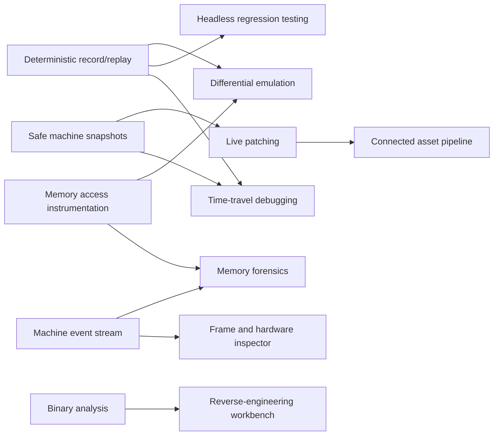
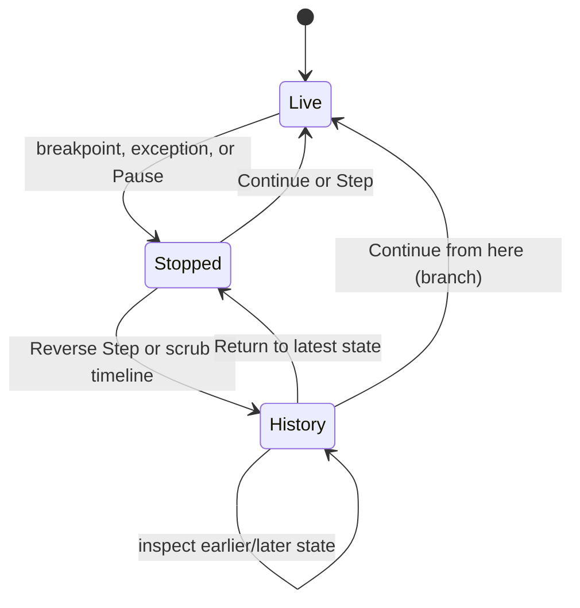

# Ambitious feature proposals

*(File: `docs/kimi-plans.md`.)*

A catalogue of eight deliberately ambitious directions for PiST, with sketches of how a user might
work with them and how they might be built. This is **not an agreed roadmap or a commitment to build
these features**. The designs are starting points for investigation, not verified implementation
specifications. No emulator instrumentation, recording format, hardware adapter, or deterministic
replay mechanism described here has been prototyped.

The common direction is to make the running ST inspectable, reproducible, and modifiable as a whole
machine. PiST already covers the ordinary write/build/run/debug loop. These proposals ask what an
IDE could do when it also understands execution over time, machine events, live code changes, and
the assets from which a program was made.

The proposals are intentionally ST-specific. They should deepen the existing product rather than
turn it into a general-purpose emulator frontend or a collection of unrelated creative tools.

## 0. Shared constraints and recommended order

### Existing foundations

Several proposals can reuse substantial pieces of the current tree:

- `IDebugBackend` separates debugger operations from their transport. The bundled `hatari-pist`
  fork remains a subprocess, and the native backend remains the stock-Hatari fallback.
- `ProgramLineMap`, `LinkMap`, and `SymbolTable` already connect runtime addresses to source lines
  and symbols. The reference tables already identify many TOS calls and their arguments.
- The media channel already carries frames, audio, and input. `EmulatorDisplayWidget` is the current
  user-facing display, while screenshots provide an existing still-frame capture path.
- `MachineState`, memory dumps, disassembly, PC history, profiling, hardware registers, watchpoints,
  and Lua stop hooks provide pieces of an inspection and automation surface.
- `RemoteControl` and `pist-mcp` are the external automation routes. New capabilities should grow
  typed operations and events there, not introduce an in-IDE chat sidebar.
- The sprite editor, `.pim` documents, bitplane exports, floppy editing, and multi-module builds
  provide starting points for the asset and reverse-engineering proposals.

### Rules that still apply

The existing subprocess, transport, and file-safety rules do not disappear because a feature is
ambitious:

1. vasm remains unmodified and subprocess-driven. Any new emulator instrumentation belongs in the
   deliberately maintained `hatari-pist` fork or in a separately proposed upstream change. PiST must
   not patch or link stock Hatari, write `hatari.cfg`, or produce symbol sidecars beside a `.PRG`.
2. Existing debugger commands retain their channel split and framing rules. New typed, framed
   messages should extend the fork's protocol rather than multiplex ad hoc text onto the native
   debugger prompt.
3. Advanced operations must advertise their availability. A stock Hatari can keep ordinary debugging
   while time travel or memory tracing is unavailable; capability detection must use capabilities,
   not version numbers.
4. Source files, projects, disk images, recordings, and generated assets go through the project's
   atomic file-writing rules. Recording a session must never silently overwrite a source or disk.
5. Large traces cannot live only in GUI-thread memory. Collection, indexing, playback, and rendering
   need explicit backpressure and bounded memory behaviour.

### Dependency order

The proposals reinforce one another rather than forming eight independent projects:



**Recommended investigation order:** deterministic replay and stopped snapshots first; memory/event
instrumentation next; then time travel, testing, forensics, and the frame inspector. Live patching
and differential hardware support should build on those primitives. The asset pipeline and binary
analysis can proceed independently.

A sensible first milestone is not a full time-travel UI. It is a small experiment that records a
short program twice and proves that its inputs and observable trace match on replay.

---

## 1. Time-travel debugging

### The idea

Let the user move backwards through execution as deliberately as they currently step forwards:

- **Reverse Step**, **Reverse Continue**, and **Run Back to Cursor**.
- Rewind to the previous hit of a breakpoint or the previous write to a watched location.
- A timeline of stops, exceptions, source lines, frames, and watchpoint hits.
- A historical, read-only view of registers, memory, disassembly, stack, and the emulated screen.
- Resume forwards from an earlier state as an explicit branch, rather than silently destroying the
  later recording.

The compelling workflow is: a program crashes, the user drags backwards to before the corruption,
inspects the responsible instruction, changes a value, and explores a different forwards execution.

### How it might look and behave

The existing Debugging layout gains a **Timeline** dock. During an ordinary session it can remain
collapsed or show only stop markers. When recording is enabled, it displays a bounded time range
with the current execution position and markers for stops and exceptions.



A possible interaction sequence:

1. The user selects **Run ▸ Record Session** before running a timing-sensitive game loop.
2. The game faults. PiST opens the normal source-level stop and adds the exception to the timeline.
3. The user chooses **Run ▸ Reverse Step**. The editor, register view, memory panes, disassembly,
   and emulator frame now describe one earlier instruction. A **History** badge makes clear that
   these values are not the live machine.
4. The user right-clicks `player_x` and chooses **Previous Write**. PiST jumps to the recorded write
   event and resolves its PC through the same source map used at an ordinary stop.
5. Choosing **Continue From Here** warns that later events will become a separate branch. The user
   can return to the original crash through the recording browser.

Editing source while viewing history must not relabel old events using a new build. A recording
needs a build identity; stale mappings should be identified as stale or refused. Historical panels
should be read-only until the user deliberately branches execution.

### Technical shape

The robust implementation is deterministic record/replay plus snapshots, not repeated use of the
current Hatari `stateload` command. `docs/FUTURE.md` §6 records why the latter does not satisfy the
central requirement: restoration resumes the machine instead of producing a stopped debugger state.
The fork therefore needs a primitive that restores a snapshot **and remains stopped at a valid
debugger boundary**.

A possible division of responsibility:

- **Emulator:** deterministic input/event recording; serializable complete machine state; snapshot
  restore without forced execution; instruction or event indexing; resume-from-snapshot.
- **Recording module in PiST:** a versioned session file, chunk indexes, compression, bounded caches,
  branch metadata, and build/ROM/machine fingerprints.
- **Backend contract:** operations such as `startRecording`, `seekRecording`, `restoreSnapshot`, and
  `recordingPosition`, exposed only when the active emulator supports them.
- **Session seam:** a new controller for Live/History/Branching state, rather than adding more flags
  to `MainWindow` or overloading `DebugSessionController`'s live-stop flags.
- **Views:** consume a selected historical `MachineState` and memory snapshot without issuing live
  debugger reads for every scrub movement.

A recording might contain:

```text
header: format version, emulator build, machine, ROM and program hashes
initial snapshot
external event log: input, disk changes, host-controlled operations
periodic snapshots + event-to-instruction/frame indexes
annotations: stops, exceptions, breakpoint hits, optional memory events
branches: parent position and new event suffix
```

Reverse Step then means “restore the nearest earlier snapshot, replay to just before the selected
instruction, and stop.” Coarse snapshot spacing controls storage; replay cost controls latency.
Those tradeoffs need measurement. Per-instruction complete snapshots would be simpler to reason
about but is unlikely to be an acceptable default.

Reverse Continue replays until the requested condition would fire, then restores the preceding safe
boundary. Breakpoints that depend on mutable debugger state or host-side Lua side effects need an
explicit policy; they cannot be assumed reversible merely because RAM was restored.

### Incremental path

1. Prove deterministic replay of one fixture with no UI, comparing a trace of registers and external
   events across runs.
2. Add snapshot-restore-and-stop to the fork and test it through a real debug session.
3. Implement backwards navigation between a small number of stops, with read-only historical state.
4. Add Reverse Step and breakpoint seeking, then branches and a recording browser.
5. Only then connect fine-grained memory events for **Previous Write**.

### Hard questions

- Does Hatari's execution contain host-time, host-filesystem, threading, or unordered-device inputs
  that must be captured or normalized for replay?
- What exactly constitutes complete state: CPU, RAM, chipset, disks, IKBD, sound, DMA, and pending
  exceptions?
- Can restore reliably re-enter the debugger without executing an extra guest instruction?
- How much storage and replay latency do representative games and demos incur?
- Which host-side actions are replayable, and which must be prohibited during recording?

---

## 2. Memory forensics and data-flow debugging

### The idea

Answer questions about *relationships in execution*, not just the current value at an address:

- Who wrote this byte? Who read it? What was the previous writer before that?
- Which instructions touched this buffer, and how often?
- Where did this pointer value originate?
- What changed in a memory range between two stops?
- Did the stack overwrite a nearby buffer, or did code read uninitialized memory?
- Which parts of RAM are code, data, screen, stack, asset storage, or still unclassified?

This goes beyond the current watchpoint model. A watchpoint is a change-tracking conditional
breakpoint: reads do not fire and writing the same value again does not fire. Forensics requires an
actual access stream or targeted emulator instrumentation.

### How it might look and behave

From a symbol, a memory-pane selection, or a source line associated with storage, the user chooses
**Trace Accesses**. A **Memory History** view offers filters for reads, writes, address range, data
width, source routine, and time range.

A typical investigation:

1. The user watches `player_state` and stops after it becomes invalid.
2. **Show Writers** lists the relevant write events, newest first, with old and new values, PC,
   instruction, source line, and frame number.
3. Selecting an event shows the instruction and a historical memory/register snapshot. If time
   travel is unavailable, the same list remains useful as a forward-only trace.
4. **Trace Value Origin** follows a selected register or memory value backwards through recorded
   data-flow edges until instrumentation can no longer prove its origin.
5. **Compare With Previous Stop** displays changed bytes in the selected range rather than requiring
   the user to inspect two hex dumps manually.

A separate **Memory Map** could visualize address ranges by classification. Classifications supplied
by symbols and the basepage are knowable; inferred screen buffers or asset regions must be labelled
as inferred and carry their evidence.

### Technical shape

The central new primitive is a memory-access event, conceptually:

```text
sequence, cycle/frame, PC, effective address, width, read/write,
old value (for writes), new value (for writes), optional CPU context
```

The emulator should collect events at the point where effective addresses and values are known. A
post-instruction RAM scan cannot identify the writer and would miss transient values. The debugger
must not stop on every access: events need a low-overhead ring buffer or chunked stream with explicit
sequence numbers and overflow reporting.

Two collection modes serve different costs:

- **Targeted watch:** instrument selected ranges, with a fixed event budget. Useful for ordinary
  interactive investigations.
- **Whole-trace record:** capture all accesses for a bounded interval. Much more expensive and only
  meaningful after measuring throughput and trace size.

PiST can maintain an index keyed by address/range and sequence. A query returns an event page, not
an unbounded array. Backpressure or a deliberate dropped-event marker is essential; silently losing
exactly the write being investigated would make the feature misleading.

For value-origin tracking, dynamic taint/data-flow analysis needs semantics for each executed
instruction: which destination bits depend on which source bits, including effective-address
calculation, flags, memory, and partial register writes. That is a substantial second project. A
first version should provide writer history without claiming full provenance.

Potential checks such as stack bounds and uninitialized reads require definitions. Stack ranges can
come from the basepage and symbols; “uninitialized” needs a defined snapshot/allocation model and
must avoid labelling ROM- or hardware-initialized RAM as a program bug.

### Incremental path

1. Add targeted write events for one address range and prove old/new values and PCs against a real
   program.
2. Build the Memory History query/view and source attribution, forward-only.
3. Add read events and range comparison between stops.
4. Integrate recorded events with time travel.
5. Investigate value provenance only after the event stream's cost and correctness are established.

### Hard questions

- What is the performance cost of instrumentation in Hatari's CPU and device memory paths?
- Do DMA, blitter, and other non-CPU writes carry a different origin model? They must not be
  attributed to whichever CPU instruction happened to be current.
- How are self-modifying code and address-space changes represented?
- What retention limit and dropped-event behaviour remain useful without promising completeness?

---

## 3. Frame and hardware inspector

### The idea

A RenderDoc-style inspector for an ST frame: select a frame or scanline and understand the machine
activity that produced it.

Potential views include:

- VBL/HBL, MFP timers, raster interrupts, exceptions, and DMA on one timeline.
- Palette writes, framebuffer/base changes, blitter operations, and selected hardware writes.
- PSG and IKBD activity beside video timing.
- CPU profile ranges and source routines over the same time axis.
- Frame comparison, with changed pixels and differing event sequences.
- Navigation from a hardware event to the responsible PC, instruction, and source line.

This is aimed at real ST problems: a flickering raster, a missed VBL, a palette change one line too
late, or a routine that overruns its frame budget.

### How it might look and behave

The user selects **Capture Frame** beside the emulator display. PiST freezes a captured frame, not
necessarily the live session, and opens a **Frame Inspector** layout.

The screen appears above a horizontal scanline timeline. Moving over the image selects a scanline;
the timeline centres its events. Clicking a palette event reveals the instruction and source line.
The user can step through events in that line while a read-only hardware panel shows the captured
register values.

A typical workflow:

1. Capture the frame containing a broken raster split.
2. Click the affected band in the image.
3. Filter the timeline to palette and shifter writes.
4. Compare it with a known-good frame from another recording or machine configuration.
5. Open the responsible interrupt handler at the instruction that occurred late.

For a frame-overrun problem, the user instead selects the VBL-to-VBL range and sees routine cycles
or samples over it. Existing profiler data can supply a coarse overlay, but it should not be
presented as an exact event history unless the instrumentation provides one.

### Technical shape

The emulator needs a versioned **machine event stream**, separate from human-readable `info`
output. Possible event families:

```text
frame/scanline markers; interrupt raise/acknowledge/entry/return;
CPU instruction markers; memory-mapped I/O reads/writes;
video base/mode/palette changes; blitter/DMA operations;
PSG/IKBD activity; optional CPU profile samples.
```

Each event needs a common clock domain and sequence number. The clock must be defined precisely:
cycles alone are not enough unless the recording also describes clock changes and how they map to
scanlines. Events should refer to emulator state at their occurrence, not ask PiST to reconstruct
it from a later stop.

A frame capture can be a bounded bundle: metadata, frame pixels, events for a selected interval,
and sparse hardware-state snapshots. Incremental video history could initially reconstruct only the
final frame and selected scanline, rather than promise pixel-perfect emulation state at every event.

Implementation sketch:

- Add event hooks in the fork at the hardware and CPU boundaries, behind a capture flag.
- Stream fixed-size binary records or length-prefixed messages in chunks. Do not format per-event
  debugger text on the UI thread.
- Write/index captures outside the GUI thread or in bounded chunks with measured responsiveness.
- Map event PCs to source through an immutable build map.
- Present a virtualized timeline: paint only visible event ranges and fetch details on selection.
- Keep the ordinary media channel for live viewing; a capture references frames rather than
  replacing that channel with a second rendering path.

The existing profiler remains useful independently. Sharing its attribution layer makes sense;
forcing exact per-line cycle semantics onto sampled profiling does not.

### Incremental path

1. Define the event clock and emit frame markers plus one event type, such as palette writes.
2. Build a capture file and a minimal scanline list, verified against a known test pattern.
3. Add source navigation and frame selection.
4. Add interrupts, video-base changes, blitter, and profiling overlays in measured increments.
5. Add known-good frame comparison after the single-frame model is trustworthy.

### Hard questions

- Which hardware operations can Hatari observe at the required accuracy, and which are already
  aggregated after the fact?
- What is the exact relationship between event timestamps and displayed scanlines on each machine?
- Can capture be enabled only around a frame without perturbing emulation timing or overwhelming
  the host?
- What does “instruction responsible” mean for queued or asynchronous device activity?

---

## 4. Deterministic record/replay and headless program testing

### The idea

Record a session's initial state and external inputs, replay it exactly, and use that primitive for
repeatable assembly-program tests.

A test should be able to boot a fixture, provide keyboard/joystick input, run a specified number of
frames, assert memory or registers, compare a screenshot/audio/trace, and retain a recording when it
fails. Opening that failure in PiST should navigate to the first failed expectation or divergence.

This is not merely a Lua stop-hook runner. Stop hooks react at debugger stops; deterministic tests
also need controlled input and machine time while the program runs.

### How it might look and behave

A **Tests** dock lists test fixtures in the project. A test could be a declarative file initially,
with Lua reserved for assertions that genuinely need logic:

```lua
-- Illustrative API, not an agreed schema.
local s = session.boot { program = "build/game.prg", machine = "ste", frames = 120 }
s:input { frame = 10, joystick = 0, right = true }
s:input { frame = 11, joystick = 0, fire = true }
s:runToFrame(120)
s:expectMemory("player_x", "w", 84)
s:expectFrame("expected/level-start.png")
```

The user presses **Run Tests** without an emulator window. A failure reads like a build diagnostic:

```text
input/session.lua: player_x: expected 84, got 81 at frame 120
Recording: build/test-results/input-session/failure.pistrec
```

Choosing **Open Recording** loads the final state; choosing **First Divergence** compares against a
baseline recording if one exists. Expected-frame updates must be deliberate and reviewable, never a
hidden side effect of running the suite.

Remote control and MCP should be able to start the same suite and receive structured results. They
should invoke a headless runner rather than simulate GUI clicks.

### Technical shape

Recording and replay belong in the emulator, where every external event can be scheduled against
the guest clock. The host-side test runner should be a widget-free module so it can run in CI.

A recording needs at least:

- A format version and complete machine/ROM/program configuration.
- An initial snapshot or deterministic boot recipe.
- Timed keyboard, mouse, joystick, disk, and other host-originated events.
- Optional observations and checkpoints used for comparison.
- Enough emulator identity to reject or explicitly migrate incompatible recordings.

For determinism experiments, compare a trace across repeated runs. The first prototype can trace a
small sequence of frame number, PC, registers, and selected hardware state. A matching final RAM
hash alone is weaker evidence: two runs can diverge and converge again.

A separate runner process is preferable for CI isolation: one crash or hung fixture must not take
down the IDE or block all later tests indefinitely. PiST can orchestrate runner jobs and collect
structured results. Timeouts must stop the guest and preserve any usable recording.

Assertions need a single source of truth. Symbol names should resolve through the existing listing
and relocation model, not a second debug-expression evaluator. Frame comparisons need an explicitly
chosen colour conversion and comparison tolerance; exact hashes are appropriate only where the whole
pipeline is deterministic.

Headless audio comparison is a later extension. It multiplies format and determinism questions and
is not required for the first useful memory/screenshot runner.

### Incremental path

1. Prototype deterministic replay and publish a trace-comparison experiment, including negative
   controls where different input must produce a difference.
2. Stabilize a minimal recording format and headless launch.
3. Implement frame counts, input injection, symbol-based memory assertions, and JUnit-like or JSON
   results for CI.
4. Add screenshot assertions and failure recordings.
5. Integrate the Tests dock, remote verbs, and first-divergence navigation.

### Hard questions

- Can all supported Hatari configurations replay deterministically, or only an explicitly listed
  subset?
- How are wall-clock-dependent operations, host paths, and removable media controlled?
- Does debugger attachment itself alter timing or the event stream?
- What test isolation is needed for floppy writes and GEMDOS hard-drive writes?

---

## 5. Live patching without restarting the program

### The idea

Change assembly or an asset, rebuild it, and apply an intentional subset of the changes to a running
machine while preserving its execution state.

Useful cases include adjusting a routine, replacing a sprite or palette, iterating on game logic,
and testing a fix at the exact state where a bug appeared. This is much more than “build and run
again”: code can move, callers can contain absolute addresses, active frames can return into old
code, and data can point into the old image.

Safety comes from restricting what can be patched and showing the proposed writes, not from
pretending arbitrary relocation is safe.

### How it might look and behave

With a session stopped, the user edits a routine or `.pim` and selects **Run ▸ Preview Live Patch**.
PiST builds into a separate staging directory and displays a patch plan:

| Change | Decision | Reason |
|---|---|---|
| `update_player` | Patch in place | Same section offset and size |
| `hero.pim` frame data | Reload asset | Declared fixed destination `hero_frames` |
| `collision_check` | Restart required | Size changed; return address is active in this routine |
| `score_table` | Restart required | Absolute references have not been proven relocatable |

The plan lists exact address ranges and old/new byte hashes before applying. **Take Snapshot And
Apply** creates a rollback point where supported. If applying or verification fails, PiST offers
restore or a normal restart; it never reports success merely because debugger writes were sent.

Source breakpoints and named watchpoints re-resolve after the patch. Raw-address watches remain raw
addresses and must be identified as such. Execution resumes only by an explicit user action.

### Technical shape

Start with **fixed-address, fixed-size patching**. The linker and patch planner must prove that the
replacement occupies the same runtime range and that external references needed by that range are
unchanged or included in the plan. Arbitrary whole-program relocation is a later, probably separate,
feature.

A possible patch workflow:

1. Build old and new artifacts with listings and link maps retained under PiST's build directory.
2. Compare section layouts, symbols, relocation information, and bytes.
3. Classify changes into patchable ranges, declared asset destinations, and restart-required changes.
4. Map staged section offsets through the session's live bases.
5. Require a stopped machine and reject active PCs/return addresses inside ranges whose control flow
   cannot safely be replaced.
6. Write through typed backend operations, read back the affected bytes, and verify hashes.
7. Refresh disassembly, source mappings, breakpoint plans, and symbols from the same patch result.

The code-size constraint can be supported by an explicit source/toolchain convention for patchable
routines, such as a reserved region or fixed-size section. That convention must be validated from
actual vasm/vlink output; the document does not assume a particular directive already works.

Asset patching needs a declaration connecting generated bytes to a destination symbol and expected
layout. The connected asset pipeline in §8 provides that declaration. Without it, PiST can generate
a byte file but cannot safely guess where its contents belong in a running program.

Snapshots are the rollback mechanism. The snapshot must cover all state modified by the patch and
must restore into a stopped state; this shares the time-travel prerequisite. Before that exists,
live patching can still preview and apply reversible byte changes, but “rollback” must not be
claimed if only the original bytes, not the whole machine, can be restored.

Self-modifying code, code copied into RAM, addresses held in registers or on the stack, and hardware
or DMA readers all need conservative handling. A restart-required result is a valid outcome.

### Incremental path

1. Implement a read-only old/new build diff and patch-plan model, with no emulator writes.
2. Support same-range replacement of one leaf routine while stopped, with read-back verification.
3. Rebind mappings and breakpoints, then prove the patched routine executes in a real session.
4. Add declared fixed-address asset updates.
5. Add stopped snapshots and rollback, then investigate broader relocation only if demand justifies
   it.

### Hard questions

- What layout guarantees can vasm/vlink provide for patchable regions?
- Which references and active-stack cases can be detected reliably from available symbols and state?
- How does patching interact with relocation performed by GEMDOS on each run?
- Can a user understand and override a conservative refusal without bypassing verification?

---

## 6. Differential emulation and real-hardware comparison

### The idea

Run the same recording under multiple machine configurations, ROMs, emulators, or physical hardware
and identify where their observable behaviour diverges.

A compatibility failure should become more than “works on my STE”: it should produce two recordings,
the first differing event or checkpoint, and source attribution where possible.

Physical hardware is the moonshot. Cross-configuration emulation is useful first and avoids making
the entire feature depend on a custom adapter.

### How it might look and behave

A **Compatibility Matrix** lets the user select a recording and several targets:

| Target | Result | First divergence |
|---|---|---|
| STfm, TOS 1.02, 1 MiB | Pass | — |
| STE, TOS 1.62, 4 MiB | Frame differs | Frame 812, scanline 143 |
| TT, EmuTOS | Exception | `trap_handler`, PC `0x…` |
| Physical STE | Trace differs | Checkpoint 38; expected PC `…`, observed `…` |

Selecting a row opens a comparison view: two timelines, frames, register/memory checkpoints, and the
first common-clock position that differs. The user can jump to the source event on either side.

The comparison policy must be visible. Final-screen equality, RAM checkpoints, CPU trace equality,
and exact frame timing are different claims. Timing-sensitive comparisons should not treat a slower
host or an uninstrumented device as a guest-program mismatch without evidence.

### Technical shape

The recording format from §4 supplies the common input. Each target produces observations using the
same conceptual clock and checkpoint identifiers. A comparison engine streams checkpoints and stops
at the first mismatch rather than requiring two complete traces in memory.

For emulator targets, PiST can orchestrate separate processes with isolated configuration and disk
copies. Results should distinguish:

- Configuration unsupported or target failed to start.
- Program assertion failed.
- Observation mismatch.
- Recording could not replay deterministically on one target.

Real hardware needs a separate transport and observation mechanism. A possible adapter could inject
input and sample an exposed debug/serial output, but stock ST hardware cannot provide complete CPU
state or arbitrary memory history. The practical contract is therefore **checkpoints and observations
exported by a small guest-side harness**, not transparent whole-machine debugging.

That harness would itself alter the program and timing, so results must state the instrumentation.
Hardware video/audio capture can add external evidence, but synchronization to emulated scanlines is
another measurement problem. No particular adapter, debug cartridge, or serial protocol is assumed
to exist.

Divergence localization should use progressively finer checkpoints around the first coarse mismatch.
This is more efficient than collecting maximum-detail traces for every target from the start.

### Incremental path

1. Replay one recording under two emulator configurations and compare frame/checkpoint observations.
2. Build the target matrix and first-divergence report.
3. Add source/event navigation and distinguish unsupported targets from behavioural failures.
4. Define a minimal guest checkpoint protocol and prove it with one physical-machine setup.
5. Add external capture only if it answers a demonstrated compatibility question.

### Hard questions

- Which observations are comparable across machines whose hardware is intentionally different?
- How are TOS/ROM differences separated from differences caused by the program?
- What clock and checkpoint protocol can physical hardware support without excessive intrusion?
- Can legal redistribution rules for original ROMs be respected in a shared test matrix? Original
  TOS images remain user-supplied.

---

## 7. Reverse-engineering workbench

### The idea

Open a `.PRG` or floppy without source and turn it into a navigable, progressively annotated
analysis project:

- Recursive disassembly with explicit code/data decisions.
- Entry points, traps, jump tables, strings, palettes, screen-like data, and candidate assets.
- Renameable symbols and comments that persist independently of the original binary.
- Runtime-informed discovery of code reached during execution.
- Export to a buildable vasm project when the reconstruction is complete enough.
- A clear distinction between observed facts, user annotations, and heuristic guesses.

The goal is not perfect automatic decompilation. It is a workbench where each discovery improves
navigation and can eventually become source.

### How it might look and behave

**File ▸ Open Binary For Analysis…** asks for a program and creates an analysis project beside a
user-chosen output directory, never modifying the original. The initial view shows sections and the
entry point. The user can run the binary, mark code or data, rename an address, and inspect TOS calls
with the existing reference information.

A possible workflow:

1. Open an old `.PRG`; PiST identifies its header, sections, relocations, and entry point.
2. Start recursive disassembly from the entry point. Unresolved indirect jumps stay explicitly
   unresolved instead of causing the whole data section to be disassembled.
3. Run under the emulator with code-coverage recording. Executed addresses become observed-code
   candidates, including paths static analysis missed.
4. Rename `loc_1204` to `read_joystick`; that name follows subsequent debugger views and exported
   assembly.
5. Mark a region as a Degas image or sprite sheet and open it in the image tools. If the encoding is
   only a guess, the UI says so.
6. Export assembly and data include files into a new directory, build the result, and compare its
   behaviour with the original recording.

### Technical shape

The existing source line map assumes listings and symbols. Binary analysis needs a parallel model,
not fake source lines injected into `ProgramLineMap`:

- **Binary image:** TOS header, sections, relocation table, symbols if present, and original hashes.
- **Analysis database:** address ranges, instruction boundaries, cross-references, code/data state,
  names, comments, provenance, and confidence.
- **Disassembly engine:** decode instructions and control flow; retain unknown and conflicting
  states rather than choosing silently.
- **Runtime observations:** executed PCs and optional memory/hardware events from the fork.
- **Export layer:** emit vasm syntax, data includes, and a project file, then use the ordinary build
  service to validate what was produced.

A TOS executable's load-time relocations and GEMDOS runtime base must be handled explicitly. Static
analysis addresses should use a stable image-relative coordinate; runtime addresses are translated
through the live basepage. This avoids persisting a relocated address as if it belonged to the file.

Recursive traversal starts from known entry points and follows direct branches/calls. Computed jumps
need target tables supplied by analysis, observation, or the user. Code discovered by execution is
strong evidence that bytes executed, but not automatically proof of every instruction boundary in a
self-modifying program.

Round-trip byte equality is a useful first export test where the source format permits it, but it is
not the only acceptable result: relocations or assembler encodings can differ while behaviour stays
equivalent. Behavioural comparison belongs to §4 and §6.

Asset detection should be conservative and evidence-based. Recognizing dimensions or a palette-like
sequence is a hypothesis; a user-confirmed region is different. The image editor can consume an
extracted range through the existing codecs where formats match.

### Incremental path

1. Parse the TOS image and relocation data; implement a read-only linear/recursive disassembly view.
2. Add persistent names, comments, code/data overrides, and cross-references.
3. Integrate live addresses and runtime coverage.
4. Export a minimal fixture to assembly and assemble it with vasm.
5. Add asset extraction and original-versus-rebuilt behavioural comparison.

### Hard questions

- How are multiple load addresses, self-modifying code, and runtime-generated code represented?
- Which disassembler library or implementation can be shipped under PiST's licensing and packaging
  constraints?
- What analysis format remains stable as annotations and heuristics evolve?
- When should export refuse to claim a buildable reconstruction?

---

## 8. Connected demo/game asset pipeline

### The idea

Expand the sprite work into a connected asset graph for ST games and demos: tilemaps, collision and
sprite metadata, level data, sound/music, packing, and generated assembler interfaces.

The important feature is not the number of editors. It is a declared connection from source assets
to generated bytes, symbols, build dependencies, runtime buffers, and debugger views. Editing an
asset should be able to rebuild exactly its dependents, preview it on the target machine, and later
support a declared live update.

`docs/FUTURE.md` §12 deliberately deferred tilemaps and automatic asset export. This proposal would
reverse those deferrals only as a separate decision; it does not imply that Degas PI2/PI3 or other
computer platforms should also enter scope.

### How it might look and behave

An **Assets** dock lists source assets and their products. Selecting one shows its inputs, generated
files, exported symbols, destination layout, size, and which build targets consume it.

A possible project declaration, illustrative rather than a decided `.pistproject` schema:

```text
hero.pim
  phase: walk
  export: build/assets/hero.dat (masked, 16 pre-shifts)
  symbols: HERO_FRAMES, HERO_FRAME_STRIDE
  runtime destination: hero_frames

level01.map
  tileset: tiles.pim
  export: build/assets/level01.dat (column-major, packed)
  symbols: LEVEL01_WIDTH, LEVEL01_DATA
```

Editing `hero.pim` marks only its outputs stale. Build regenerates them before assembling or
linking, using content hashes so unchanged outputs do not cause needless downstream work. Generated
files live under the build directory by default and are not silently rewritten in the source tree.

In the debugger, a memory pane at `hero_frames` can offer **Open Source Asset**. Selecting a runtime
byte range highlights the phase/frame/pre-shift block from the existing bitplane layout. A packing
report shows uncompressed and packed size, RAM requirements, and—only if actually measured—decode
cost on a selected target.

Later, with live patching, an explicitly declared fixed-layout asset can be updated in the stopped
machine without rebuilding the whole program.

### Technical shape

Introduce a widget-free asset model and build planner:

- **Asset document:** source path, type, stable identifier, export options, and dependencies.
- **Export rule:** output under the active build directory, format, symbol names, and optional
  runtime destination/layout declaration.
- **Content graph:** source and option hashes determine staleness; generated outputs declare the
  symbols and byte map they produce.
- **Build integration:** `BuildService` plans asset steps before vasm/vlink and treats export
  diagnostics like other build diagnostics. It does not shell out through uncontrolled string
  concatenation or rewrite project settings.
- **Debugger integration:** a byte map connects generated ranges back to source documents. Runtime
  addresses still resolve through the existing symbol/live-base machinery.

The existing `ImageDocument`, `StFormats::exportBitplaneData`, and `bitplaneLayout` are the natural
first exporters because they already describe blocks and offsets. Tilemaps need a new document model
(a grid of tile references), not another meaning forced into animation phases. A tileset change must
be a dependency of every map that references it.

Sound/music should start with import, metadata, playback/preview where feasible, and export through
a defined codec. Building a full tracker is a separate product decision and should not block the
asset graph. Likewise, compression codecs need measurable benefits and a corresponding 68000 decoder
before appearing as options.

Generated symbol include files can be consumed through vasm's ordinary include mechanisms. Their
paths belong in build-generated include arguments/settings without editing unrelated source or
user configuration. The exact project schema needs a versioning and migration decision before
implementation.

Atomic writes apply to generated assets too. A failed export leaves the previous valid output and
marks the build failed; it must not let assembly consume a half-written file.

### Incremental path

1. Put the existing `.pim` bitplane exporter behind a declared build asset rule and content hash.
2. Generate a byte map and symbol include; verify that build, completion, and debugger navigation
   use the same result.
3. Add the Assets dock and stale/dependency reporting.
4. Add a tilemap document/editor as a consumer of the graph, not as a prerequisite for it.
5. Add packing and sound import/export only where a real demo needs them, then declared live asset
   updates after §5 is ready.

### Hard questions

- Should asset declarations live in `.pistproject`, a separate manifest, or asset documents? The
  answer must avoid duplicating export settings in several sources of truth.
- How are generated includes exposed without making hand-written project settings surprising?
- What stable IDs survive moving/renaming source assets and exporting to a new build directory?
- Which editors genuinely benefit ST development enough to justify their maintenance cost?

---

## 9. What to prototype first

A useful research programme can answer the largest shared unknowns without committing to all eight
features:

| Experiment | Observable result | Unlocks |
|---|---|---|
| Replay one fixture twice | Matching or explicitly diagnosed event traces | Replay, testing, differential runs |
| Restore one snapshot while stopped | Same state, no extra guest instruction, live debugger usable | Time travel, safe patch rollback |
| Capture writes to one small range | Correct PC/old/new values with measured overhead and loss | Memory history, previous-write navigation |
| Capture one frame's palette events | Events align with the expected scanlines | Frame inspector |
| Diff two same-layout builds | Exact patch ranges plus conservative refusal cases | Live patching |
| Round-trip one tiny binary | Persistent analysis and an exported file vasm can assemble | Reverse engineering |
| Make one `.pim` a declared build input | Stale detection, reproducible export, source-to-byte navigation | Asset pipeline |

The first three should be treated as feasibility gates. If deterministic replay or stopped restore
cannot be made reliable, PiST should not emulate time travel with a UI that only appears to work.
Forward-only tracing, headless automation, the frame inspector, and the asset work would still be
valuable independently.
